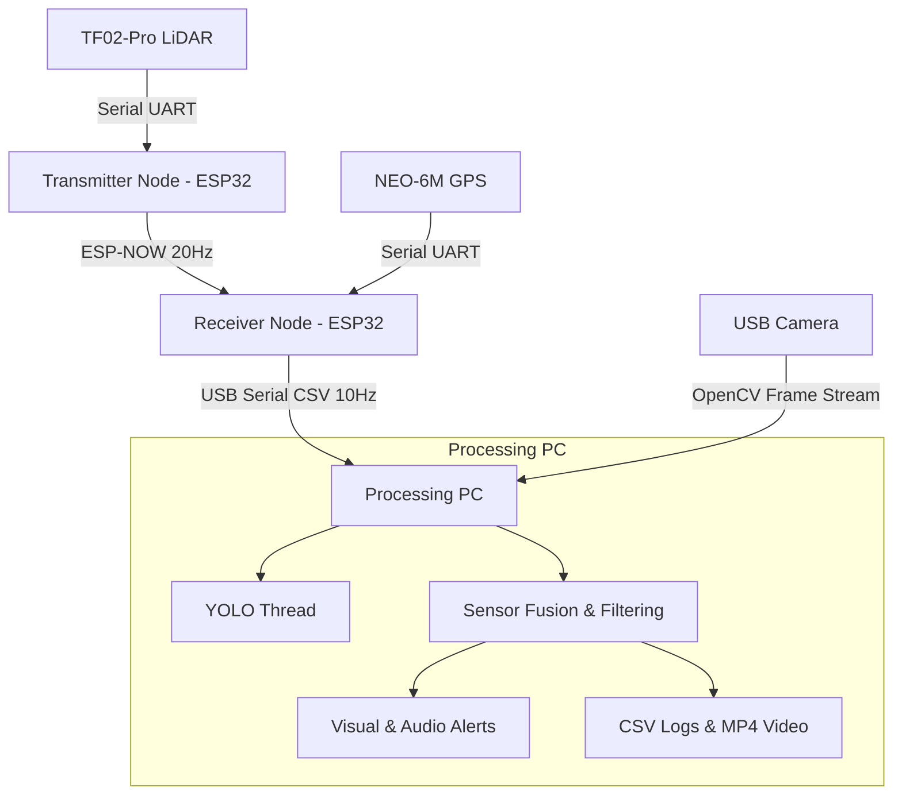

# ADAS: Forward Collision Warning with Camera + LiDAR Sensor Fusion

> **B.Sc. Capstone Project** · Computer Engineering, İstanbul Kültür University (2026)
> Authors: **Özgün Türköz**, **Beyza Aydın** · Advisor: Assist. Prof. Dr. Necip Gökhan Kasapoğlu

## 📈 Results
| Metric | Value |
|---|---|
| Mean distance-estimation error | **4.9 %** |
| Improvement over camera-only estimation | **69.2 %** |
| Real-time throughput | **20–30 FPS** on a commodity GPU |
| Tested conditions | clear, overcast, light rain, night (graceful degradation in adverse weather) |
| Total sensor cost | **≈ $160** |

---


An advanced, real-time **Advanced Driver Assistance System (ADAS)** that integrates Computer Vision (YOLOv8 & ByteTrack) with physical telemetry (TF02-Pro LiDAR & NEO-6M GPS) using multi-threaded Python processing, Median filtering, and 2D Kalman Filter state estimation to perform sensor fusion, compute Time-to-Collision (TTC), evaluate safe distances, and issue active visual and acoustic warnings.

---

## 🚀 Key Features

*   **Multi-Threaded YOLOv8 Tracking**: Offloads object detection (YOLOv8 Nano) and tracking (ByteTrack) to a dedicated CPU/GPU background thread to maintain fluid camera feed rendering (>30 FPS on compatible hardware).
*   **Sensor Fusion Engine**: Dynamically merges monocular camera depth estimations (derived from bounding box heights) with physical LiDAR distance measurements when their viewing angles and spatial estimations match.
*   **Kalman & Median Filtering**: Applies Median filters to LiDAR readings to remove outliers, and 2D Kalman filters to estimate object distance and relative approach velocity.
*   **Time-to-Collision (TTC) & Safe Distance Calculation**: Calculations adjust dynamically based on vehicle speed (from GPS) and specific class multipliers (e.g., higher margins for trucks or pedestrians).
*   **Active Warnings**: Color-coded UI indicators (Green for `SAFE`, Orange for `WARNING`, Red for `DANGER!`) paired with platform-independent audio alerts.
*   **Data Logging & Recording**: Automatically logs detailed CSV telemetry and records MP4 video captures of test sessions.

---

## 🛠 System Architecture



### 1. Transmitter Node (`transmitter/transmitter.ino`)
*   Reads distance and signal strength from a **TF02-Pro LiDAR** sensor over UART.
*   Pipes data packets wirelessly at **20Hz** to the receiver node using the low-overhead **ESP-NOW** protocol.

### 2. Receiver Node (`receiver/receiver.ino`)
*   Listens to ESP-NOW packets from the Transmitter Node.
*   Parses speed and satellite count data from a **NEO-6M GPS** sensor.
*   Combines both telemetry streams and outputs a clean CSV string via USB Serial to the host PC at **10Hz** (`speed,satellites,distance,strength,valid`).

### 3. PC Processing Unit (`adas_system.py`)
*   Captures live camera frames and aligns them with serial telemetry.
*   Runs parallel YOLOv8 inference, filters spatial anomalies, merges distance inputs, estimates state variables, calculates TTC, and controls user alerts.

---

## 📐 Pin Hookup & Hardware Connections

### Transmitter (ESP32 + TF02-Pro LiDAR)
| TF02-Pro Wire | ESP32 GPIO | Notes |
|:---|:---|:---|
| **VCC (Red)** | **5V** | External or ESP32 5V pin |
| **GND (Black)** | **GND** | Common ground |
| **TX (Green)** | **GPIO 16 (RX2)** | Hardware UART2 RX |
| **RX (White)** | **GPIO 17 (TX2)** | Hardware UART2 TX |

### Receiver (ESP32 + NEO-6M GPS)
| NEO-6M Pin | ESP32 GPIO | Notes |
|:---|:---|:---|
| **VCC** | **3.3V** | Operating voltage |
| **GND** | **GND** | Common ground |
| **TX** | **GPIO 16 (RX2)** | Hardware UART2 RX |
| **RX** | **GPIO 17 (TX2)** | Hardware UART2 TX |

---

## 📂 Project Structure

```
.
├── receiver/
│   └── receiver.ino            # ESP32 Receiver code (GPS + ESP-NOW Receiver)
├── transmitter/
│   └── transmitter.ino         # ESP32 Transmitter code (LiDAR + ESP-NOW Sender)
├── .gitignore                  # Git exclude list (logs, recordings, weights)
├── adas_system.py              # Main Python processing & UI application
└── README.md                   # Project documentation
```

---

## 🚀 Getting Started

### 1. Arduino Setup
1.  Open `receiver/receiver.ino` in the Arduino IDE. Upload it to the Receiver ESP32.
2.  Open the Serial Monitor at `115200` baud. Copy the displayed MAC address of the device.
3.  Open `transmitter/transmitter.ino` and replace `RECEIVER_MAC` with the copied MAC address:
    ```cpp
    uint8_t RECEIVER_MAC[6] = {0xXX, 0xXX, 0xXX, 0xXX, 0xXX, 0xXX};
    ```
4.  Upload the updated code to the Transmitter ESP32.

### 2. Python Setup
Make sure Python 3.9+ is installed, then install dependencies:
```bash
pip install opencv-python numpy pyserial ultralytics torch
```

### 3. Execution
1.  Connect the Receiver ESP32 to the PC via USB.
2.  Open `adas_system.py` and modify configurations near the top if necessary (e.g., `SERIAL_PORT` and `CAMERA_INDEX`):
    ```python
    CAMERA_INDEX      = 0
    SERIAL_PORT       = 'COM3'  # On Windows, or '/dev/ttyUSBX' on Linux/macOS
    BAUD_RATE         = 115200
    ```
3.  Run the system:
    ```bash
    python adas_system.py
    ```

### 4. In-App Hotkeys
*   **`F`**: Toggle Sensor Fusion (ON/OFF).
*   **`V`**: Start/Stop Video Recording (`recordings/` folder).
*   **`Q`**: Safely exit the application.

---

## 📊 Outputs & Logs
*   **`logs/session_YYYYMMDD_HHMMSS.csv`**: Contains complete, structured session logs including timestamps, tracked object classes, raw & fused distances, velocities, TTC, warning states, and vehicle speeds.
*   **`recordings/session_YYYYMMDD_HHMMSS.mp4`**: Raw video output capturing the overlaid detection frame.

---

## 👥 Authors
* **Özgün Türköz**: [LinkedIn](https://linkedin.com/in/ozgunturkozz) · ozgunturkoz3@gmail.com
* **Beyza Aydın**
* Advisor: **Assist. Prof. Dr. Necip Gökhan Kasapoğlu**

📄 The capstone report and the accompanying conference paper are available on request.
